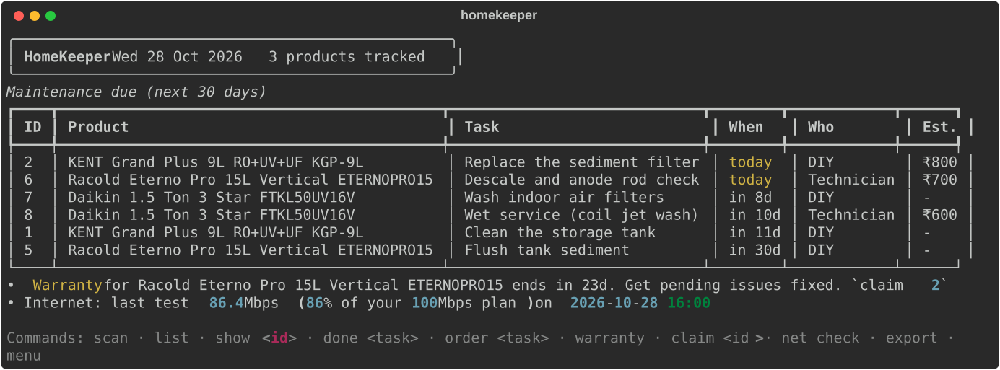
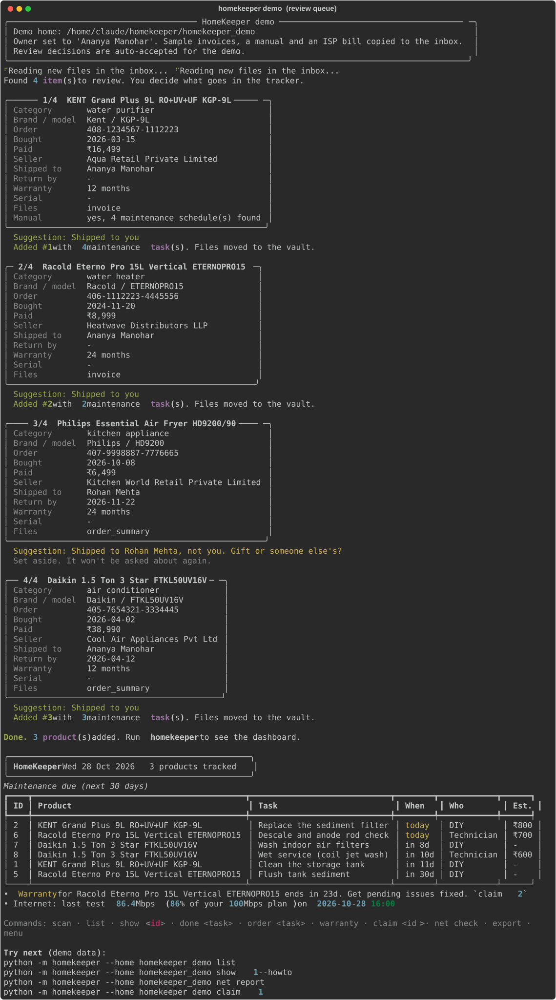
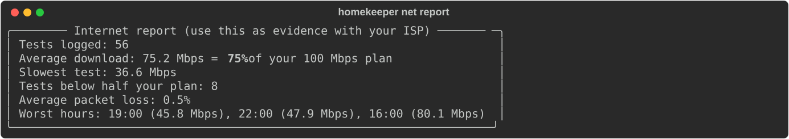

# HomeKeeper

[](https://github.com/manoharananya/homekeeper/actions/workflows/tests.yml)

**One console tool for everything you own at home: warranties, return windows, maintenance schedules and home internet health.**

Drop your invoices and manuals into one folder. HomeKeeper reads them (including scanned PDFs), works out which documents belong to which product, asks you to confirm each one, and then tracks everything for you.



---

## The everyday problem

Every home has the same mess:

- **Invoices are scattered** across email, the Amazon app and a drawer. When something breaks, nobody knows whether it is still under warranty or where the bill is.
- **Return windows close silently.** You remember the faulty item a week too late.
- **Maintenance gets forgotten.** RO filters, AC servicing, geyser descaling and chimney filters each have their own schedule, buried in a manual nobody reads. Missed maintenance means worse performance, bigger repair bills and, sometimes, a voided warranty.
- **The internet is slower than what you pay for**, and you have no evidence to show your ISP.

HomeKeeper automates the boring part: reading documents, working out dates, building schedules and reminding you. You keep control of the decisions.

## What it does

| Module | What you get |
|---|---|
| **Document intake** | Reads PDFs, photos and text. OCR is used for scanned packing slips. Classifies each file as an invoice, order page, packing slip, manual or ISP bill. Extracts product, brand, model, serial number, order number, price, purchase date, seller, return window and warranty. |
| **Smart grouping** | The invoice, order page and packing slip for one order become **one product**. Manuals are matched to the right product by brand and model. |
| **You approve everything** | Every item goes through a review: **Home / Gift / Someone else's / Skip / Edit**. If an order was shipped to someone else, HomeKeeper flags it as a likely gift. Items you set aside are never asked about again. |
| **Warranty and returns** | Warranty end date, days left, open return windows and a ready-to-send **claim pack** (serial number, order number, dates, file paths, service contact). |
| **Maintenance** | Schedules are pulled straight from the manual ("replace the sediment filter every 6 months"). A built-in library of 16 appliance categories fills the gaps. Each task says **DIY or Technician**, gives how-to steps and an estimated cost, and has a **one-step order link** for the replacement part. |
| **Upkeep spend** | Logs what each job cost and flags when upkeep reaches 40% of the purchase price (time to compare with replacing). |
| **Internet checker** | Measures speed **against the plan speed on your bill**, plus ping, jitter and packet loss. Logs results over time and reports your worst hours (evidence for your ISP). Lists the devices on your network and flags new ones. |
| **Email import (optional)** | Read-only Gmail/IMAP search for invoices and order emails. **You choose which emails to import**, and each one still goes through the Home / Gift review. |
| **Reminders** | Exports a `.ics` calendar file with every due date, warranty expiry and return deadline, so reminders show up in Google or Apple Calendar. |

### What it deliberately does not do

- **It never buys anything.** "Order" opens the exact product page (via the ASIN read from the invoice) or a pre-filled search in your browser. You check and pay yourself.
- **It never logs into Amazon or scrapes your account.** That breaks Amazon's terms and would need your password. It uses the order emails and the PDFs you download instead.
- **It never changes your mailbox.** IMAP is opened read-only. Your app password is used once and never stored.
- **No cloud.** Everything stays in one SQLite file on your computer.

---

## Quick start (2 minutes)

```bash
git clone https://github.com/manoharananya/homekeeper.git
cd homekeeper
python -m pip install -r requirements.txt

python -m homekeeper demo        # loads fictional sample data and shows the dashboard
```

The demo uses its own folder (`./homekeeper_demo`) and never touches your real data. Then try:

```bash
python -m homekeeper --home homekeeper_demo list
python -m homekeeper --home homekeeper_demo show 1 --howto
python -m homekeeper --home homekeeper_demo warranty
python -m homekeeper --home homekeeper_demo claim 2
python -m homekeeper --home homekeeper_demo net report
python -m homekeeper --home homekeeper_demo order 2 --print-only
```

**Requirements:** Python 3.9+, `rich` and `pdfplumber`.

**Optional extras:**

- `speedtest-cli` gives more accurate speed tests.
- `pytesseract` plus the [Tesseract](https://github.com/tesseract-ocr/tesseract) binary reads scanned PDFs and photos (`brew install tesseract` / `sudo apt install tesseract-ocr`).

Without these, everything else still works.

## Using it for real

```bash
python -m homekeeper            # first run asks your name(s) and internet plan, then opens the menu
```

1. **Setup.** Enter your name as it appears on orders (used to spot gifts) and your plan speed from the ISP bill.
2. **Collect.** Drop invoices, order PDFs, packing slips, manuals and your ISP bill into `~/HomeKeeper/inbox/`, or run `homekeeper mail` to pull them from email.
3. **Review.** Run `homekeeper scan`. For each item, press `h` (home), `g` (gift), `o` (someone else's), `s` (skip) or `e` (edit, then add).
4. **Live with it.** Run `homekeeper` for the dashboard and `homekeeper done 7 --cost 650 --by "technician"` after a job. `homekeeper export` updates your calendar file.



### All commands

| Command | Purpose |
|---|---|
| `homekeeper` / `homekeeper menu` | Dashboard plus interactive menu |
| `setup [--names "A, B"] [--plan 100] [--isp Airtel]` | Owner names, internet plan |
| `scan [--yes]` | Read the inbox and review new items |
| `dash` | Dashboard: what's due, warranty alerts, internet status |
| `list` / `show <id or name> [--howto]` | Products / one product with tasks, files and contacts |
| `warranty` / `claim <id>` | Warranty and return status / claim pack (also saved as `.txt`) |
| `due [--days 60]` / `done <task> [--cost] [--by] [--on]` | Maintenance due / log a job and reschedule |
| `order <task>` / `order p<id>` | Open the part to buy / reorder the product itself |
| `task <product> "title" --every 90 [--mode Technician] [--cost 500]` | Add your own recurring task |
| `contact <product> "Name" [--phone] [--url]` | Save a service contact |
| `spend` | Upkeep spend per product this year |
| `net check` / `net report` / `net devices` / `net label <MAC> "TV"` | Internet checks |
| `mail [--host] [--user] [--days 365]` | Import from email (read-only, you choose) |
| `export` | `.ics` calendar plus `products.csv` |
| `demo` | Sample data in `./homekeeper_demo` |

`python hk.py <command>` works too, and so does `pip install -e .` followed by `homekeeper <command>`.

### Run the internet check automatically

Mac/Linux, every 3 hours (`crontab -e`):

```
0 */3 * * * cd /path/to/homekeeper && /usr/bin/python3 -m homekeeper net check >/dev/null 2>&1
```

After a week, `homekeeper net report` shows your average speed as a percentage of your plan, plus the worst hours.



### Email import (Gmail)

1. Turn on 2-step verification, then create an **App Password** (Google Account > Security > App passwords).
2. Run `python -m homekeeper mail --user you@gmail.com` and paste the app password when asked. It isn't stored, and you can also set `HOMEKEEPER_IMAP_PASSWORD`.
3. Pick the emails to import (`1,3,5-7`, `all` or `none`). Then run `scan` and decide Home / Gift / Someone else for each.

---

## How it works

```
inbox/ ──► extract.py ──► intake.py ──────────► you review ──► SQLite (homekeeper.db)
 PDFs        text + OCR     group by order id      h/g/o/s/e      products, tasks, docs,
 photos      classify       match manuals                         contacts, net log
 emails      parse fields   suggest gift/home                          │
                                                                       ▼
                       dashboard · warranty · claim · maintenance · order links · .ics · net report
```

| File | Role |
|---|---|
| `homekeeper/extract.py` | PDF/OCR text, document classification, field and schedule extraction (rule based, offline) |
| `homekeeper/intake.py` | Inbox scan, grouping, manual matching, review suggestions, filing into `vault/` |
| `homekeeper/catalog.py` | 16 appliance categories: keywords, default warranty, maintenance templates, order links |
| `homekeeper/tracker.py` | Warranty, returns, due dates, spend (pure logic, tested) |
| `homekeeper/netcheck.py` | Speed test, ping/jitter/loss, ARP device scan, report |
| `homekeeper/mail.py` | Read-only IMAP search and download |
| `homekeeper/export.py` | `.ics` and CSV |
| `homekeeper/cli.py` | Console UI (menu plus subcommands, `rich` tables) |

**Data folder** (`~/HomeKeeper`, override with `--home` or `HOMEKEEPER_HOME`):

- `inbox/` is where you drop files.
- `vault/<product>/` holds the filed originals, renamed `invoice.pdf`, `manual.pdf` and so on.
- `vault/_not-home/` holds gifts and skipped items.
- `exports/` holds the calendar, CSV and claim packs.
- `homekeeper.db` holds everything else.

Back up the folder and you've backed up everything.

## Tested on real documents

The parser was developed against real Amazon.in documents:

- tax invoices (text PDF)
- "Order Details" pages saved as PDF
- scanned packing slips (OCR)

It covered headphones, an espresso machine and a tablet shipped to a different person, which was correctly flagged as "someone else's". Those personal files are **not** in this repository. The `samples/` folder holds fictional documents in the same formats, generated by `samples/make_samples.py`.

## Tests

```bash
python -m pip install pytest
python -m pytest -q          # 15 tests: parsing, OCR fixes, manual matching, gift detection, bad files, due dates
```

**Continuous integration:** every push runs `.github/workflows/tests.yml` on GitHub's servers. It installs the tool on Linux and macOS with Python 3.9 and 3.12, runs the tests, and runs the full demo plus the main commands. The badge at the top shows the result, and the **Actions** tab shows the full console output of each run.

## How AI was used

This project was built for *Introduction to AI Practical Tools* (Mini-Project 2). An AI assistant (Claude) was used to:

1. **Generate** the design and code, module by module, with one commit per feature.
2. **Debug.** 17 real bugs, found by running the tool on real invoices and on deliberately broken input, were diagnosed and fixed with AI. Each one is documented with symptom, diagnosis and fix in **[docs/AI_LOG.md](docs/AI_LOG.md)** and referenced in commit messages as `AI_LOG #n`.
3. **Document.** This README and the in-code docstrings.

## Roadmap

- Import Amazon's official "Request your data" order history export.
- Optional LLM mode for messy or multi-language manuals.
- Read the model number from a photo of the product sticker.
- Telegram or push reminders.
- Shared household mode.

## License

MIT. See [LICENSE](LICENSE).
